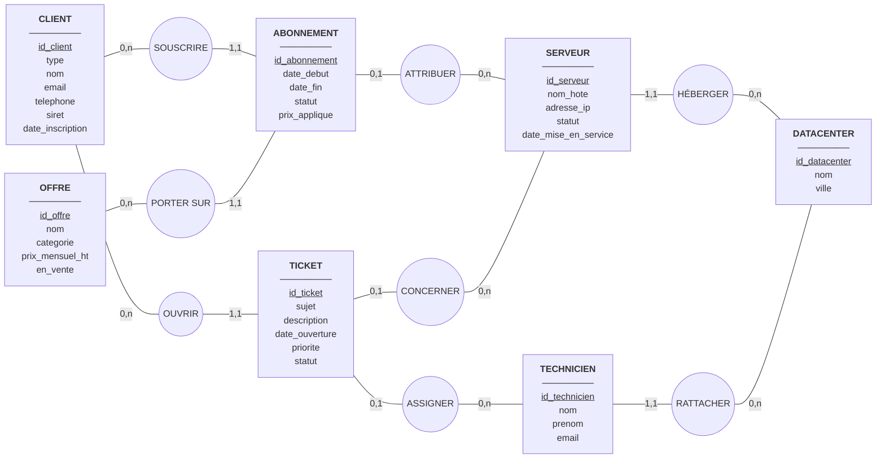
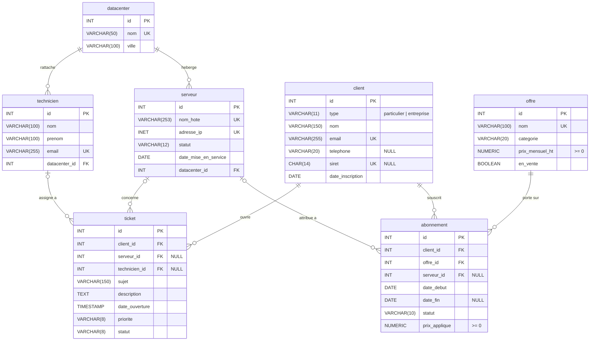
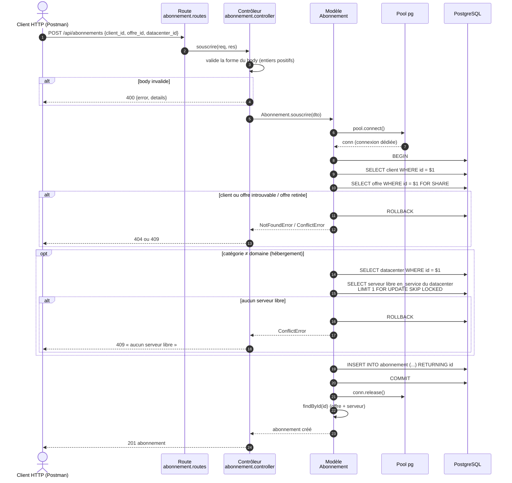

# PaLeonis – Dossier de conception (Acte 1)

> Rôles de l'équipe : voir [equipe.md](equipe.md). Contrat d'API : voir [endpoints.md](endpoints.md).

Sommaire :

1. [Dictionnaire de données](#1-dictionnaire-de-données)
2. [MCD (Merise)](#2-mcd-merise)
3. [MLD](#3-mld)
4. [Diagramme UML : séquence de la souscription (B3)](#4-diagramme-uml--séquence-de-la-souscription-b3)
5. [Contrat d'API](#5-contrat-dapi)
6. [Requêtes difficiles (B5, B9, B3)](#6-requêtes-difficiles)
7. [Répartition et stratégie Git](#7-répartition-et-stratégie-git)

---

## 1. Dictionnaire de données

Conventions : les valeurs autorisées sont stockées en minuscules sans accent ni espace (`en_service`, `resilie`…) pour éviter les problèmes d'encodage et de comparaison.

| Code | Libellé | Type | Taille | Contraintes | Entité | RG |
|---|---|---|---|---|---|---|
| id_client | Identifiant du client | Entier | | Identifiant, auto-incrémenté | CLIENT | RG1 |
| type | Type de client | Texte | 11 | Obligatoire, `particulier` ou `entreprise` | CLIENT | RG1 |
| nom | Nom ou raison sociale | Texte | 150 | Obligatoire, non vide | CLIENT | RG1 |
| email | Email du client | Texte | 255 | Obligatoire, **unique** (insensible à la casse), format `x@y.z` | CLIENT | RG1 |
| telephone | Téléphone | Texte | 20 | Facultatif, chiffres, espaces, `.`, `-`, `+` | CLIENT | RG1 |
| siret | Numéro SIRET | Texte fixe | 14 | Obligatoire **si et seulement si** entreprise, 14 chiffres, unique | CLIENT | RG1 |
| date_inscription | Date d'inscription | Date | | Obligatoire, défaut : date du jour | CLIENT | RG1 |
| id_offre | Identifiant de l'offre | Entier | | Identifiant | OFFRE | RG2 |
| nom_offre | Nom de l'offre | Texte | 100 | Obligatoire, unique | OFFRE | RG2 |
| categorie | Catégorie | Texte | 20 | Obligatoire, `vps`, `mutualise`, `dedie`, `domaine` | OFFRE | RG2 |
| prix_mensuel_ht | Prix mensuel HT catalogue | Décimal | 10,2 | Obligatoire, **≥ 0** | OFFRE | RG2 |
| en_vente | Offre en vente | Booléen | | Obligatoire, défaut vrai | OFFRE | RG2 |
| id_abonnement | Identifiant de l'abonnement | Entier | | Identifiant | ABONNEMENT | RG3 |
| date_debut | Date de début | Date | | Obligatoire, défaut : date du jour | ABONNEMENT | RG3 |
| date_fin | Date de fin | Date | | Facultative, ≥ date_debut, obligatoire si résilié | ABONNEMENT | RG3 |
| statut_abonnement | Statut | Texte | 10 | Obligatoire, `actif`, `suspendu`, `resilie` | ABONNEMENT | RG3 |
| prix_applique | Prix appliqué à la souscription | Décimal | 10,2 | Obligatoire, ≥ 0 | ABONNEMENT | RG3 |
| id_datacenter | Identifiant du datacenter | Entier | | Identifiant | DATACENTER | RG4 |
| nom_datacenter | Nom du datacenter | Texte | 50 | Obligatoire, unique | DATACENTER | RG4 |
| ville | Ville | Texte | 100 | Obligatoire | DATACENTER | RG4 |
| id_serveur | Identifiant du serveur | Entier | | Identifiant | SERVEUR | RG5 |
| nom_hote | Nom d'hôte | Texte | 253 | Obligatoire, **unique** | SERVEUR | RG5 |
| adresse_ip | Adresse IP | INET | | Obligatoire, **unique**, IPv4 ou IPv6 valide | SERVEUR | RG5 |
| statut_serveur | Statut du serveur | Texte | 12 | Obligatoire, `en_service`, `maintenance`, `hors_service` | SERVEUR | RG5 |
| date_mise_en_service | Date de mise en service | Date | | Obligatoire | SERVEUR | RG5 |
| id_ticket | Identifiant du ticket | Entier | | Identifiant | TICKET | RG6 |
| sujet | Sujet | Texte | 150 | Obligatoire, non vide | TICKET | RG6 |
| description | Description | Texte long | | Obligatoire, non vide | TICKET | RG6 |
| date_ouverture | Date et heure d'ouverture | Horodatage | | Obligatoire, défaut : maintenant | TICKET | RG6 |
| priorite | Priorité | Texte | 8 | Obligatoire, `basse`, `normale`, `haute`, `critique`, défaut `normale` | TICKET | RG6 |
| statut_ticket | Statut du ticket | Texte | 8 | Obligatoire, `ouvert`, `en_cours`, `resolu`, `ferme`, défaut `ouvert` | TICKET | RG6 |
| id_technicien | Identifiant du technicien | Entier | | Identifiant | TECHNICIEN | RG7 |
| nom_technicien | Nom | Texte | 100 | Obligatoire | TECHNICIEN | RG7 |
| prenom | Prénom | Texte | 100 | Obligatoire | TECHNICIEN | RG7 |
| email_pro | Email professionnel | Texte | 255 | Obligatoire, unique, se termine par `@paleonis.fr` | TECHNICIEN | RG7 |

Données **calculées, donc non stockées** :

- « serveur libre / attribué » (RG5) : un serveur est attribué s'il existe un abonnement **non résilié** qui le référence. Le stocker serait redondant et risquerait de devenir incohérent.
- « chiffre d'affaires mensuel » (B9) : somme des `prix_applique` des abonnements actifs.

---

## 2. MCD (Merise)



Source [Mocodo](https://www.mocodo.net) équivalente (à coller sur mocodo.net pour obtenir l'image) :

```
CLIENT: id client, type, nom, email, telephone, siret, date inscription
SOUSCRIRE, 0N CLIENT, 11 ABONNEMENT
ABONNEMENT: id abonnement, date debut, date fin, statut, prix applique
PORTER SUR, 11 ABONNEMENT, 0N OFFRE
OFFRE: id offre, nom, categorie, prix mensuel ht, en vente

OUVRIR, 0N CLIENT, 11 TICKET
ATTRIBUER, 01 ABONNEMENT, 0N SERVEUR
HEBERGER, 11 SERVEUR, 0N DATACENTER

TICKET: id ticket, sujet, description, date ouverture, priorite, statut
CONCERNER, 01 TICKET, 0N SERVEUR
SERVEUR: id serveur, nom hote, adresse ip, statut, date mise en service
DATACENTER: id datacenter, nom, ville

ASSIGNER, 01 TICKET, 0N TECHNICIEN
TECHNICIEN: id technicien, nom, prenom, email
RATTACHER, 11 TECHNICIEN, 0N DATACENTER
```

### Justification des cardinalités

| Association | Cardinalité | Justification (règle de gestion) |
|---|---|---|
| CLIENT – SOUSCRIRE | 0,n | RG3 « un client peut souscrire à plusieurs offres » ; un client vient de s'inscrire peut n'en avoir aucune. |
| ABONNEMENT – SOUSCRIRE | 1,1 | RG3 : un abonnement est la souscription *d'un* client. |
| OFFRE – PORTER SUR | 0,n | RG3 « une même offre peut être souscrite par plusieurs clients » ; une offre neuve n'a pas encore d'abonné. |
| ABONNEMENT – PORTER SUR | 1,1 | RG3 : un abonnement porte sur une seule offre. |
| ABONNEMENT – ATTRIBUER | 0,1 | RG5 « un abonnement d'hébergement reçoit un serveur ; un abonnement nom de domaine n'en a pas besoin ». |
| SERVEUR – ATTRIBUER | 0,n | RG5 « un serveur peut être libre (0) ou attribué à un seul abonnement » **à un instant donné**. Comme on conserve l'historique (RG8), un serveur peut avoir été attribué successivement à plusieurs abonnements résiliés : sur la durée c'est 0,n, avec la contrainte « un seul abonnement non résilié à la fois » portée par un index unique partiel (voir MLD). |
| SERVEUR – HÉBERGER | 1,1 | RG4 « chaque serveur est hébergé dans un seul datacenter ». |
| DATACENTER – HÉBERGER | 0,n | RG4 « PaLeonis possède plusieurs datacenters », chacun héberge plusieurs serveurs (0 pour un datacenter en construction). |
| CLIENT – OUVRIR | 0,n | RG6 « les clients ouvrent des tickets ». |
| TICKET – OUVRIR | 1,1 | RG6 : un ticket est ouvert par un client. |
| TICKET – CONCERNER | 0,1 | RG6 « un ticket peut concerner un serveur précis du client, ou aucun ». |
| SERVEUR – CONCERNER | 0,n | Un serveur peut faire l'objet de plusieurs tickets. |
| TICKET – ASSIGNER | 0,1 | RG7 « un ticket est assigné à un technicien au plus ». |
| TECHNICIEN – ASSIGNER | 0,n | RG7 « un technicien traite plusieurs tickets ». |
| TECHNICIEN – RATTACHER | 1,1 | RG7 « chaque technicien est rattaché à un datacenter ». |
| DATACENTER – RATTACHER | 0,n | Plusieurs techniciens par datacenter. |

### Choix de modélisation à défendre

- **ABONNEMENT est une entité, pas une association porteuse** entre CLIENT et OFFRE. Un même client peut souscrire deux fois la même offre (deux serveurs dédiés identiques, par exemple), donc le couple (client, offre) ne peut pas identifier l'abonnement. De plus, l'abonnement est lui-même relié à un serveur : une association ne peut pas participer à une autre association en Merise classique.
- **Particulier / entreprise** : une seule entité CLIENT avec un attribut `type`. La spécialisation (héritage) n'apporte qu'un seul attribut propre (`siret`) : deux tables supplémentaires compliqueraient toutes les requêtes pour rien. La cohérence « SIRET si et seulement si entreprise » est garantie par une contrainte `CHECK`.
- **Prix appliqué** stocké dans ABONNEMENT : ce n'est pas une redondance avec `prix_mensuel_ht`, car le prix catalogue peut changer ensuite (RG3).
- **Offre retirée** : un booléen `en_vente` plutôt qu'une suppression (RG2).

---

## 3. MLD

Notation : <u>clé primaire</u>, #clé étrangère.

- **datacenter** (<u>id</u>, nom, ville)
- **client** (<u>id</u>, type, nom, email, telephone, siret, date_inscription)
- **offre** (<u>id</u>, nom, categorie, prix_mensuel_ht, en_vente)
- **serveur** (<u>id</u>, nom_hote, adresse_ip, statut, date_mise_en_service, #datacenter_id)
- **technicien** (<u>id</u>, nom, prenom, email, #datacenter_id)
- **abonnement** (<u>id</u>, #client_id, #offre_id, #serveur_id, date_debut, date_fin, statut, prix_applique)
- **ticket** (<u>id</u>, #client_id, #serveur_id, #technicien_id, sujet, description, date_ouverture, priorite, statut)

Pas de table de jointure : la relation n,n client ↔ offre (RG3) passe par l'entité ABONNEMENT, qui devient une table avec deux clés étrangères. Toutes les autres associations sont de type 1,n ou 0,n : la clé étrangère migre du côté 1,1 / 0,1.



### Contraintes portées par la base

| Table | Contrainte | Règle |
|---|---|---|
| client | `UNIQUE (lower(email))` | RG1 : deux clients ne peuvent pas avoir le même email (même avec une casse différente) |
| client | `CHECK (type IN ('particulier','entreprise'))` | RG1 |
| client | `CHECK ((type = 'entreprise') = (siret IS NOT NULL))` | RG1 : SIRET pour les entreprises, et seulement pour elles |
| client | `CHECK (siret ~ '^[0-9]{14}$')`, format email, format téléphone | RG1 |
| offre | `CHECK (prix_mensuel_ht >= 0)` | RG2 : prix jamais négatif |
| offre | `CHECK (categorie IN (...))`, `UNIQUE (nom)` | RG2 |
| abonnement | `CHECK (statut IN ('actif','suspendu','resilie'))` | RG3 |
| abonnement | `CHECK (date_fin IS NULL OR date_fin >= date_debut)` | RG3 |
| abonnement | `CHECK (statut <> 'resilie' OR date_fin IS NOT NULL)` | RG3/B4 : un abonnement résilié a une date de fin |
| abonnement | `UNIQUE INDEX (serveur_id) WHERE statut <> 'resilie'` | RG5 : un serveur n'est attribué qu'à **un seul** abonnement en cours, tout en gardant l'historique |
| serveur | `UNIQUE (nom_hote)`, `UNIQUE (adresse_ip)`, type `INET` | RG5 |
| serveur | `CHECK (statut IN (...))` | RG5 |
| technicien | `UNIQUE (email)`, `CHECK (email LIKE '%@paleonis.fr')` | RG7 : email professionnel |
| ticket | `CHECK (priorite IN (...))`, `CHECK (statut IN (...))` | RG6 |
| client | **trigger** `BEFORE DELETE` qui lève une erreur si le client a un abonnement non résilié | RG8 |

### Comportement à la suppression des clés étrangères

| Clé étrangère | ON DELETE | Pourquoi |
|---|---|---|
| serveur.datacenter_id | RESTRICT | On ne détruit pas un datacenter qui héberge encore des serveurs. |
| technicien.datacenter_id | RESTRICT | Idem : il faut d'abord réaffecter les techniciens. |
| abonnement.client_id | CASCADE | RG8 : le trigger interdit de supprimer un client avec un abonnement actif ou suspendu. S'il ne reste que des abonnements résiliés, la suppression du client (demande RGPD) emporte son historique. Résilier, en revanche, ne supprime rien. |
| abonnement.offre_id | RESTRICT | RG2 : une offre ne se supprime pas, on la retire de la vente. La base le garantit même si quelqu'un tente un `DELETE`. |
| abonnement.serveur_id | RESTRICT | On ne détruit pas un serveur référencé par un abonnement (même résilié, pour garder l'historique) : on le passe `hors_service`. |
| ticket.client_id | CASCADE | Les tickets n'ont pas de sens sans leur client. |
| ticket.serveur_id | SET NULL | Le ticket reste, il ne concerne simplement plus de serveur. |
| ticket.technicien_id | SET NULL | Si un technicien quitte l'entreprise, ses tickets redeviennent non assignés. |

Règles vérifiées par le code (impossibles ou trop lourdes en `CHECK`, car elles portent sur plusieurs tables) :

- un abonnement « nom de domaine » n'a pas de serveur, un abonnement d'hébergement en a un (B3) ;
- on ne souscrit pas à une offre retirée de la vente (RG2) ;
- le serveur d'un ticket doit appartenir au client qui l'ouvre (RG6) ;
- un ticket ne passe `en_cours` que s'il est assigné, et suit le cycle de vie `ouvert → en_cours → resolu → ferme`.

---

## 4. Diagramme UML : séquence de la souscription (B3)

**Pourquoi ce diagramme ?** La souscription est la seule opération qui touche plusieurs tables dans une transaction. Le diagramme de séquence montre l'ordre exact des requêtes, l'endroit où la connexion dédiée est prise et rendue, et chaque cas où l'on fait `ROLLBACK`. C'est aussi lui qui répartit clairement les responsabilités MVC : la route aiguille, le contrôleur valide le HTTP, le modèle porte le SQL.



---

## 5. Contrat d'API

Voir le document dédié : [endpoints.md](endpoints.md).

---

## 6. Requêtes difficiles

### B5 – Fiche complète d'un client

Deux requêtes : les informations du client, puis ses abonnements avec l'offre et le serveur éventuel.

```sql
SELECT id, type, nom, email, telephone, siret, date_inscription
FROM client
WHERE id = $1;

SELECT a.id, a.date_debut, a.date_fin, a.statut, a.prix_applique,
       o.id AS offre_id, o.nom AS offre_nom, o.categorie,
       s.id AS serveur_id, s.nom_hote, s.adresse_ip, s.statut AS serveur_statut,
       d.nom AS datacenter_nom, d.ville AS datacenter_ville
FROM abonnement a
JOIN offre o            ON o.id = a.offre_id
LEFT JOIN serveur s     ON s.id = a.serveur_id      -- jointure serveur
LEFT JOIN datacenter d  ON d.id = s.datacenter_id
WHERE a.client_id = $1
ORDER BY a.date_debut DESC, a.id DESC;
```

### B9 – Tableau de bord

```sql
-- chiffre affaires mensuel
SELECT COALESCE(SUM(prix_applique), 0) AS ca_mensuel_ht,
       COUNT(*)::int AS abonnements_actifs
FROM abonnement
WHERE statut = 'actif';

-- chiffre affaires categorie
SELECT o.categorie,
       COALESCE(SUM(a.prix_applique), 0) AS ca_mensuel_ht,
       COUNT(a.id)::int AS abonnements_actifs
FROM offre o
LEFT JOIN abonnement a ON a.offre_id = o.id AND a.statut = 'actif'
GROUP BY o.categorie
ORDER BY ca_mensuel_ht DESC;

-- serveurs datacenter statut
SELECT d.id, d.nom, d.ville,
       COUNT(s.id)::int AS total,
       COUNT(s.id) FILTER (WHERE s.statut = 'en_service')::int   AS en_service,
       COUNT(s.id) FILTER (WHERE s.statut = 'maintenance')::int  AS maintenance,
       COUNT(s.id) FILTER (WHERE s.statut = 'hors_service')::int AS hors_service
FROM datacenter d
LEFT JOIN serveur s ON s.datacenter_id = d.id
GROUP BY d.id
ORDER BY d.nom;
```

### B3 – Souscription (transaction)

```sql
BEGIN;

-- client existe
SELECT id FROM client WHERE id = $client_id;

-- offre disponible
SELECT id, categorie, prix_mensuel_ht, en_vente FROM offre WHERE id = $offre_id FOR SHARE;

-- serveur libre
-- verrou serveur
-- souscription unique
SELECT s.id
FROM serveur s
WHERE s.datacenter_id = $datacenter_id
  AND s.statut = 'en_service'
  AND NOT EXISTS (SELECT 1 FROM abonnement a
                  WHERE a.serveur_id = s.id AND a.statut <> 'resilie')
ORDER BY s.id
LIMIT 1
FOR UPDATE SKIP LOCKED;
-- echec transaction

-- creation abonnement
INSERT INTO abonnement (client_id, offre_id, serveur_id, date_debut, statut, prix_applique)
VALUES ($client_id, $offre_id, $serveur_id, CURRENT_DATE, 'actif', $prix_mensuel_ht)
RETURNING id;

COMMIT;   -- validation
```

### B4 – Résiliation

Le serveur redevient libre **automatiquement** : « libre » se calcule à partir des abonnements non résiliés, il n'y a donc rien d'autre à mettre à jour.

```sql
UPDATE abonnement
SET statut = 'resilie', date_fin = CURRENT_DATE
WHERE id = $1 AND statut <> 'resilie'
RETURNING id;
```

### B8 – Tickets non fermés d'un technicien

```sql
SELECT t.*
FROM ticket t
WHERE t.technicien_id = $1 AND t.statut <> 'ferme'
ORDER BY array_position(ARRAY['critique','haute','normale','basse']::varchar[], t.priorite),
         t.date_ouverture;
```

---

## 7. Répartition et stratégie Git

Voir [equipe.md](equipe.md).
